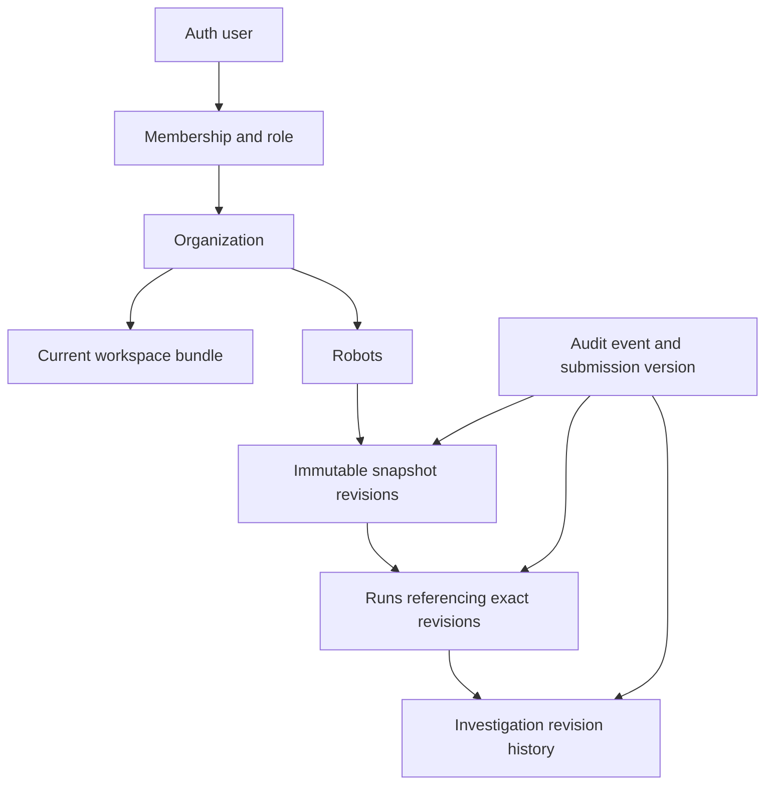

# Tavrik operating guide and completion map

November 1 backend update: use [B13 operations and release evidence](backend-operations.md) for the current B1–B12 compatibility matrix, client onboarding, command/report recovery and remaining deployment gates. The October inventory below is historical; incremental history, client roles, connectors and reports now have separate feature guides. No customer hosting or public launch is established.

October 20 audit: see [base prompts 1–10 and exact manual fixes](base-prompts-audit-2026-10-20.md) for fresh tests, hosted checks, all ten stage statuses and the remaining activation steps. The dated counts below remain historical snapshots.

Latest account update: see [account access](account-access.md) for the new Create account, Forgot password and Change password screens, same-server no-sign-in demo, and required Supabase email settings. The original account setup inventory below predates those changes.

Verified state: 2026-10-18. Business scope: [build.md](../build.md), sections 1–3 and 6–8. Detailed execution history: [build progress](build-progress.md). Everything currently seeded in the hosted project is synthetic. Technical verification is not customer validation.

October 20 update: original Prompt 8 adds the owner-only **Four-week pilot · owner dashboard**, opt-in activity, weekly measurement revisions and JSON summary export. Its three tables are now installed and synthetically verified on the hosted target. Open the dashboard after selecting an organization; follow the [pilot guide](pilot-guide.md). The counts in the older inventory below remain an October 18 snapshot.

## Open the right place

| Place | What you see | Where changes survive |
| --- | --- | --- |
| [Connected app](http://127.0.0.1:3002) | Sign-in, organization, robots, Record/Compare/History, investigations | Hosted Supabase after **Save to organization** |
| [File workspace](http://127.0.0.1:3001/workspace/) | Local record tools | Tab memory until **Export JSON**; requires its separate development server |
| [Public demo](http://127.0.0.1:3001/demo/) | Bundled synthetic example | Fixed fixtures, separate from your organization |
| [Supabase tables](https://supabase.com/dashboard/project/wdwtscztkpqkejkovkob/editor) | Raw saved application records | Hosted PostgreSQL |
| [Auth users](https://supabase.com/dashboard/project/wdwtscztkpqkejkovkob/auth/users) | Login accounts | Supabase Auth |
| [SQL editor](https://supabase.com/dashboard/project/wdwtscztkpqkejkovkob/sql) | Queries and schema inspection | Administrator access |

Yes, the database is visible on the Supabase website in Google Chrome. Select **Vector Graph Database**, project `wdwtscztkpqkejkovkob`. Its name does not mean this app implements vector search or a graph database. The database is online; the app server currently runs only on this PC. Docker and WSL are unnecessary for this hosted setup.

The app login differs from your Supabase dashboard login. Open the private, ignored `.cache/hosted-supabase-accounts.json` file locally and use its `owner` account. Select **UNIFY Synthetic A**. `other` owns Synthetic B; `viewer` can read A. Do not share this file or paste passwords into bug reports. Public signup is disabled; new accounts require administrator setup. See [hosted setup](hosted-supabase.md).

## What is completed

| Capability | Implementation and verification | Remaining boundary |
| --- | --- | --- |
| Scope/discovery materials; marketing website | Implemented locally | No completed public launch or validated customer claims |
| Robot history and successful/failed comparison | Implemented; automated tests pass | Differences do not identify causes |
| Manual records, JSON import/export, corrections | Implemented; revision/reference tests pass | Explicit save/export; no automatic tab synchronization |
| Custom components, JSON/CSV mapping and units | Implemented; import/comparison tests pass | Approved metadata only; no CAD geometry parsing |
| Python capture and run-result handoff | Implemented; interoperability tests pass | Live ROS and engineer trials unverified |
| Hosted Auth, organizations, owner/member/viewer roles | Implemented; synthetic live isolation checks passed | Administrator-assisted onboarding; no Google OAuth or billing |
| Persistent saves, audit, collector upload/retry/revocation | Implemented; synthetic live checks passed | Bounded whole-workspace storage, not large-scale incremental storage |
| Investigation notes, states, reports, exact revisions | Implemented; database regression and synthetic persistence checked | Human confirmation requires evidence; no automated root cause |
| Recovery | PGlite simulated recovery test passes | Managed Supabase recovery drill still required |
| Four-week pilot preparation and measurements | Implemented; synthetic hosted persistence and isolation checked | No actual customer pilot, measured customer value or paid validation |
| Public launch, advanced integrations/predictions | Planned; compatibility page is synthetic preview only | No public release or working robot command platform |

The original Stages 1–7 and later B1–B13 backend prompts are different numbering systems. Original Prompt 7 investigations does not complete B7 client portals. See [backend prompts](backend-master-prompts.md) before requesting a later stage.

## Whole application database

In Table Editor choose schema **public**, select a table, then expand JSON cells such as `payload` or `bundle`. Filter by `org_id` to inspect one organization. The administrator dashboard can see both organizations; that is different from an app user's permissions. Use the app for writes so validation, history, audit and workspace copies stay consistent.

Counts below are a point-in-time synthetic inventory, not fixed targets.

| Table | Rows | Contents | App presentation |
| --- | ---: | --- | --- |
| organizations | 2 | ID, name, creation time | Organization selector |
| memberships | 3 | Organization, Auth user, owner/member/viewer role | Access and owner team controls |
| workspaces | 2 | Current complete JSON bundle, version, updated time | Loaded workspace and saved version |
| robots | 8 | ID, robot payload, submission version | Robot list and Add robot |
| snapshots | 10 | Robot ID, immutable snapshot ID/revision, payload, submission version | Exact configuration, Compare and History |
| runs | 10 | Robot, exact snapshot ID/revision, outcome/time payload | Run history, target and baseline |
| corrections | 0 | New/prior revision, field correction payload, submission version | Append corrections in History |
| mappings | 0 | Approved metadata mapping payload and submission version | JSON/CSV field approval/reuse |
| investigations | 3 | Investigation ID, target run, latest state/evidence note | Current investigation |
| investigation_revisions | 3 | Revision, target/baseline/retest, note/evidence payload, submission version | Append-only investigation history/report |
| invitations | 0 | Email, role, hashed token, expiration/use/revocation | Owner invitations and acceptance |
| collector_credentials | 1 | Organization/robot scope, creator, hashed token, expiration/revocation | Owner collector access; test credential is revoked |
| ingestion_receipts | 6 | Principal/request ID, body hash, resulting version | Retry deduplication; no dedicated screen |
| audit_events | 8 | Authenticated actor or collector, action/time, workspace version | Administrator inspection; no dedicated audit screen |

Zero rows means the current cloud fixtures have not used that feature. Two read-only views, **components** and **evidence_references**, derive hardware/custom fields and provenance from exact snapshots; they are not extra editable copies.

Stage 8 adds `pilot_plans` (immutable scope/baseline/criteria), `pilot_reviews` (append-only weekly measurements and notes), and `pilot_events` (activity kind/time/deduplication metadata). These are owner-readable and contain no robot configuration payload. The app now has 17 base tables; use the inspection query for current counts rather than treating the historical inventory as live.

Most domain data lives inside JSON, rather than a separate SQL column per measurement. Snapshots contain hardware component/revision; software commit/dirty/build identity; firmware; model identity; dataset lineage reference; calibration; grip force; test procedure/object/conditions; and approved custom component fields with types and units. Each domain field distinguishes **known**, **unknown**, and **not-applicable**. **Unchanged** is a comparison result, never proof that two unknown values match. Provenance records source, method, author, observed time, recorded time and evidence availability. Manual hardware remains manual, with stale confirmations highlighted. Runs keep their original revision even after a correction.



The whole database also includes provider-managed schemas: **auth** (accounts, sessions, identity/MFA/OAuth machinery), **storage** (object-storage infrastructure), **realtime** (subscriptions/messages), **extensions** (query statistics), **supabase_migrations** (applied migration history), and **vault** (secret infrastructure). Their existence does not mean Tavrik uses every feature. Do not edit managed tables or export session/token/vault values to inspect the product. The [inspection SQL](database-inspection.sql) lists all visible schema objects and all public columns without retrieving secret contents. Run it in SQL Editor; if only the last result appears, select and execute an individual SELECT. It also checks counts, exact run references, bundle consistency, RLS and helper grants.

## First walkthrough

1. Sign in to the connected app as the generated owner and choose Synthetic A. Note its saved version.
2. Choose a seeded robot with runs. In **Compare**, select a failed target and an earlier successful baseline. Inspect grouped changes and both snapshots' evidence, missing information and condition warnings.
3. In **Investigate this run**, choose the baseline, enter author/note and use **investigating** or **hypothesis**. Append the entry. Confirmation requires an evidence note or qualifying retest; it is an engineer's conclusion.
4. Click **Save to organization**. Wait for success and an updated saved version. Refresh/sign out and back in; reopen the same robot and investigation.
5. In Supabase inspect `workspaces`, `investigation_revisions` and `audit_events`, filtered by that organization. The new history and submission version should be present.
6. Use **Export JSON** for the current draft, **Export saved records** for the database copy, or **Export investigation report** for one investigation. Reports include draft changes and are not workspace backups/import files.

For your own synthetic test, use **Add robot**, then **Record** hardware/configuration. Use **History** corrections to fill relevant metadata while preserving previous revisions. Record a test with the exact intended snapshot and the actual outcome. Record the later configuration and result separately, compare the runs, then save. Use unique IDs; never invent pick counts for a generic test. Keep real customer records out of this synthetic environment while hosting gates remain open.

Importing a workspace into beta appends validated records and requires a save. The file-only workspace import replaces its current draft. Export before switching/reloading. Collector captures and approved JSON/CSV imports can prepare a test draft; they do not invent the test result. See [local records](local-records.md), [custom metadata](custom-metadata.md), [collector](collector.md) and [investigations](investigations.md) for complete field workflows.

Owners manage team invitations, roles and collector credentials in **Manage team and collector access**. Members can record/save; viewers read/compare/export. Invitations do not send email automatically. Keep invitation and collector tokens private; revoke unused access. Do not exercise Delete organization against records you want to retain.

## Start and maintain it

If port 3002 is not running, open PowerShell in the repository:

```powershell
$env:Path = "$PWD\.tools\node-v24.21.0-win-x64;$env:Path"
npm run dev:beta
```

Leave that terminal open. A running server reloads code; after changing server environment configuration, restart it. Do not start another copy if port 3002 is already occupied. `beta/.env.local` holds the hosted server configuration; keep it private. `dev:local` and `db:*` scripts target Docker-based local Supabase, not this hosted project. Hosted migration versions differ from repository filenames: follow the mapping in [hosted setup](hosted-supabase.md), not a blind migration push/reset.

## Find and report bugs

Use synthetic records. Save/export your draft before refresh or a destructive test. Keep a second browser profile for viewer/other-organization tests; sharing a browser session can replace the current login.

| Check | Expected behavior |
| --- | --- |
| Save, refresh, sign out/in | Saved record and version persist |
| Edit without saving | Draft changes are not represented as saved cloud data |
| Correct a snapshot | New revision; old run still points at old revision |
| Unknown values or incompatible conditions | Visible uncertainty/warnings, no invented sameness/cause |
| Viewer account | Read/export permitted; editing denied |
| Other organization | No access to A's private records |
| Two tabs edit the same saved version | Stale save rejected; preserve/export draft before reload |
| Invalid or oversized JSON | Actionable rejection, no partial record installation |
| Investigation confirmation without evidence | Rejected |
| Mobile narrow width | Controls usable without page overflow |

For a problem, record: date, app URL, role, synthetic organization/record IDs, exact steps, expected result, actual result, saved version, repeatability, and a redacted screenshot/error. In Chrome DevTools, Network shows the failing `/api/` request and status; Console shows browser errors. Never share cookies, Authorization headers, full environment files or private record bodies. Check the server terminal for matching failures without adding secret logging.

Common failures: 401 usually means sign in again; 403 means membership/role/scope denial; 409 means a conflicting or stale save (export draft, reload, reconcile); 413 means payload limits; 503 means configuration or upstream availability needs inspection. Use the actual response message to narrow the cause. A successful status endpoint is not a database save test.

Run `npm test` and `npm run test:beta` with the bundled Node directory on PATH. For browser suites/configuration see the package scripts and [private beta guide](private-beta.md); mocked browser tests do not prove hosted persistence. Current workspace bounds are 2 MiB and up to 1,000 entries per bounded collection. Read the [dated audit](bug-audit-2026-10-18.md) for exactly what was checked.

Before customer use: complete managed backup/restore, production hosting/TLS and operational hardening, review leaked-password protection, rotate the secret previously shared in chat, and verify the intended deployment end to end. No public launch, customer validation, automatic robot control, billing or guaranteed bug-free operation is claimed.
